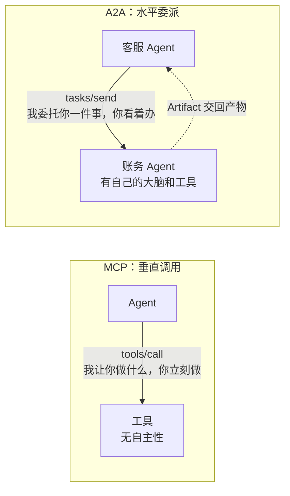
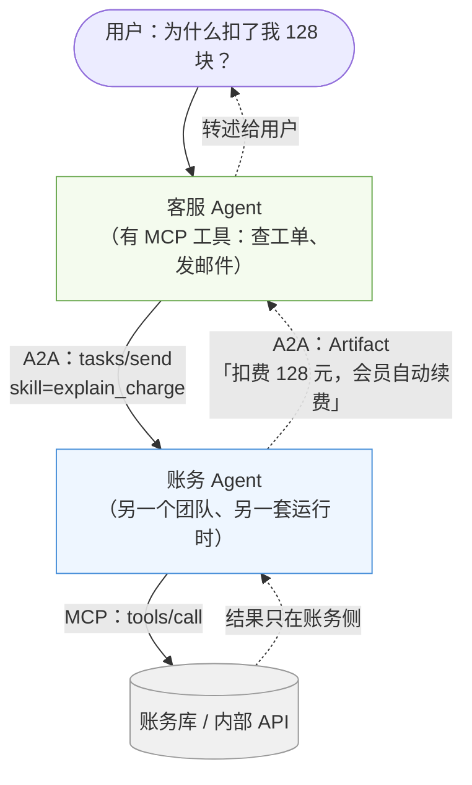
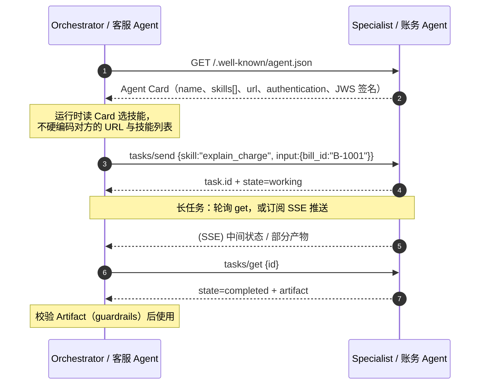
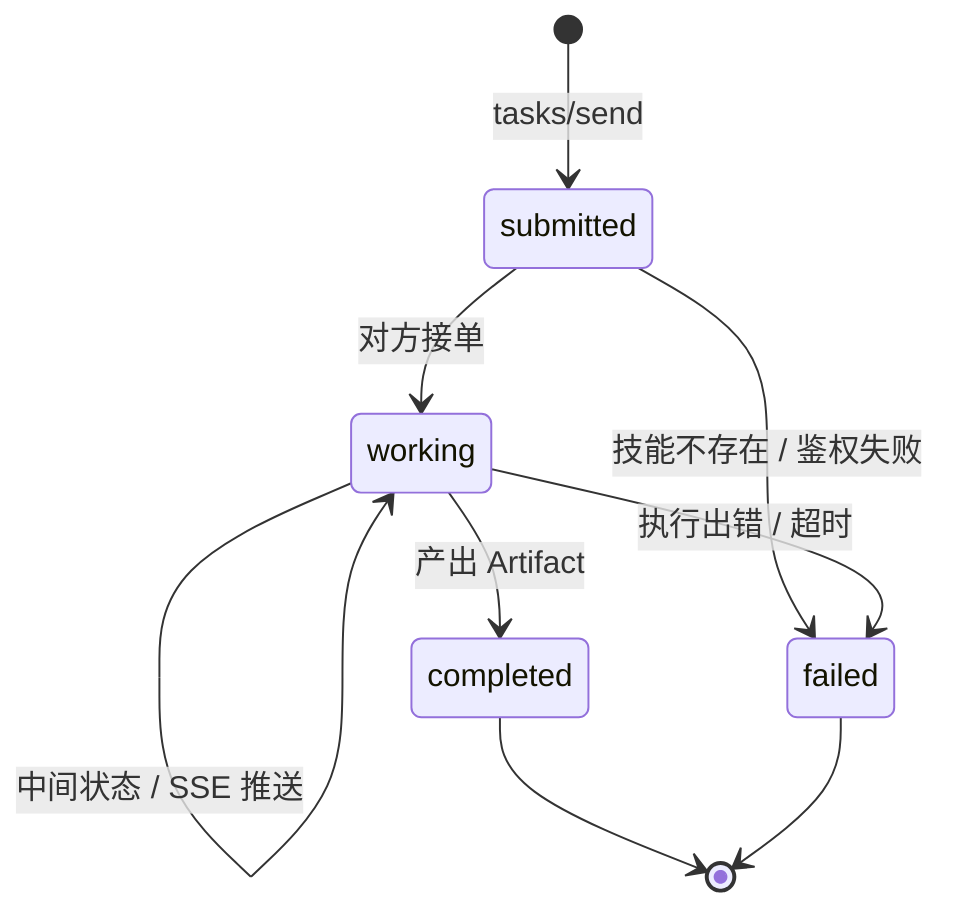
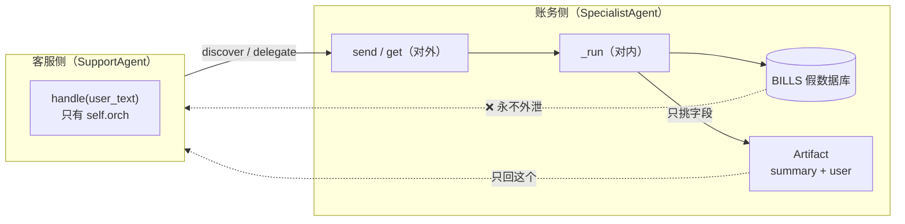
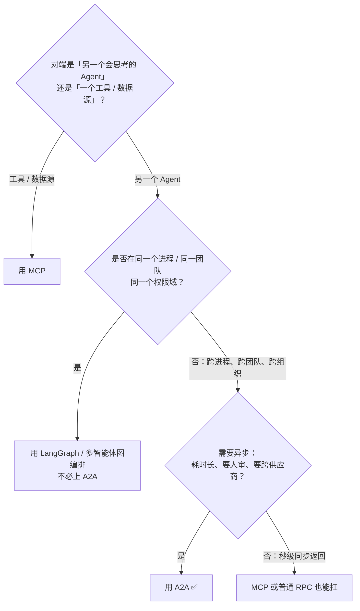

# A2A 理解指南（图解版）

> 这份文档是 [README.md](./README.md) 的「理解向补充」：README 回答「A2A 是什么、有哪些概念」，这份回答「为什么需要它、和 MCP 到底差在哪、隔离是怎么发生的」。
> 适合：第一次接触 A2A 的人，以及被「MCP 和 A2A 有什么区别」问住的人。

---

## 0. 三十秒版本

一句话：**MCP 是手（Agent → 工具），A2A 是工单（Agent → Agent）。**



关键差异不在传输，而在**对端有没有自主性**：工具不会拒绝你、不会反问你、不会花三小时；另一个 Agent 会。

---

## 1. 为什么不能继续用 MCP 解决

假设客服 Agent 要回答「这笔账单为什么多扣了」：

| 方案 | 会发生什么 | 问题 |
|---|---|---|
| 直接给客服 Agent 挂账务库的 MCP server | 客服 Agent 自己查库、自己解释 | 客服侧拿到了不该拿的数据库权限与内部 prompt |
| 让账务团队把工具开放出来 | 对方要暴露 `select_from_bills` 这类底层 schema | 耦合到对方内部实现，对方改表你就挂 |
| **A2A 委派** | 客服只说「解释 B-1001 这笔扣费」，拿回一段解释 | 权限边界 = 组织边界 |

所以 A2A 的存在理由不是技术上的「跨进程调用」——那是任何 RPC 都能做的事——而是**组织与权限边界**：

- 对方不开放内部 tools，只开放「我能办哪些事」；
- 你不想、也不该看到对方的连接串、内部 state、prompt；
- 对方可能要跑很久、可能要人工审批，你得能异步等。

---

## 2. 全景图：MCP 和 A2A 是怎么叠在一起的

这张图建议记牢，**绝大多数「区别是什么」的问题看它就够了**：



读法：

- **上面一跳（水平）是 A2A**：两个大脑之间，传的是「任务」和「产物」。
- **下面一跳（垂直）是 MCP**：大脑和工具之间，传的是「调用」和「结果」。
- **虚线是回程**：账务 Agent 永远不会把 `SELECT * FROM bills` 的结果原样交给客服，它只交 Artifact。

反过来说：**如果你的系统图上只有中间一个 Agent 和下面一排工具，那就不需要 A2A。**（README 里那句「给单 Agent 套 A2A 只是仪式」就是这个意思。）

---

## 3. 一次委托的完整时序



注意第 2 步的 **Agent Card 是「可发现」的关键**：你在运行时读它，而不是把对方的地址和技能写死在代码里。这也是为什么 Card 要能 JWS 签名——否则任何人都能宣称「我是你们财务 Agent」。

---

## 4. Task 状态机



工程上真正花钱的地方是后三条：

- **长任务一定会断**，所以幂等 task id、超时、重试要一开始就设计；
- **`working` 可能持续很久**，要么轮询要么 SSE，别写成同步阻塞调用；
- **`failed` 也要能读**：`error` 字段要能让人和模型都看懂（配合 [Eval](../../reliability/eval/) 按 hop 打分）。

---

## 5. 四个核心概念（信封里有什么 / 没有什么）

| 概念 | 是什么 | **不是**什么 |
|---|---|---|
| **Agent Card** | 可发现的名片：名字、技能、端点、鉴权要求，可签名 | 不是内部 tool schema，别把 SQL 结构写进去 |
| **Task** | 一次委托的生命周期（含 id、state） | 不是对方的内部状态机 |
| **Artifact** | 对方交回来的产物（报告、工单号、文件） | 不是对方的数据库行、不是对方的 prompt |
| **Message** | 任务过程中的对话 / 澄清 | 不是你和对方模型的完整聊天记录 |

一句话：**A2A 只保证信封一致，不规定 Agent 内部怎么想。** LangGraph、ADK、AutoGen、自研 while 循环都可以当一端。

---

## 6. 隔离到底怎么发生的（对着 mvp.py 看）

`mvp.py` 最有价值的地方不是状态机，而是**边界是代码层面强制的**。实际跑 `python3 mvp.py`：

```text
=== Agent Card ===
billing-agent @ memory://billing
skills: ['explain_charge']

=== 用户: 为什么扣了 1001 这笔？ ===
[客服转述] 账单 B-1001 扣费 128.0 元，原因：会员自动续费。

=== 隔离检查：客服侧看不到 BILLS ===
SupportAgent 属性: ['orch']
```

拆开看三件事：



1. **客服侧只有 `orch` 这一个属性**（输出里 `SupportAgent 属性: ['orch']` 就是证据），它拿不到 `BILLS`。
2. **`_run` 是私有的**：账务 Agent 对外的面只有 `card` + `send` + `get`，内部怎么查库是它自己的事。
3. **Artifact 是「挑过的」字段**：`_run` 里只把 `amount`、`reason`、`user` 拼成一句 summary 放进 artifact——这正是真实系统里该做的脱敏动作，代码里那行注释 `# 内部细节不出现在 artifact 里` 就是整个 A2A 的价值所在。

顺带一个细节：MVP 里 `handle()` 同步 `get` 一次就拿结果，注释也标了「生产里这里是 SSE / 轮询」。别把它当同步 RPC 抄进生产。

---

## 7. 什么情况下别上 A2A



还有一条命名上的坑：**ACP 和 A2A 不是一回事**。A2A 的对端是另一个大脑；ACP（Agent Client Protocol）的对端是一个**界面**（编辑器 / 客户端）。IBM 早期的 ACP（Agent Communication Protocol）已于 2025 年并入 A2A，和今天的 Agent Client Protocol 同名不同物，讨论时先确认说的是哪个。

---

## 8. 常见误解（FAQ）

| 误解 | 正解 |
|---|---|
| 「A2A 是 MCP 的替代品」 | 互补且通常是上下两层：A2A 委派，被委派方再用 MCP 调自己的工具。 |
| 「多智能体就该用 A2A」 | 同进程图编排（LangGraph）用不着；跨进程 / 跨组织才需要。 |
| 「把内部 tool schema 写进 Card 更方便」 | 等于把内部实现耦合出去，对方改表你就挂；Card 只写「能办哪些事」。 |
| 「委托出去就安全了」 | 发出去的入参、收回来的 Artifact 都要过 [guardrails](../../reliability/guardrails/)，否则跨组织注入就发生在这一跳。 |
| 「Task 发出去等结果就行」 | 长任务一定会断；幂等 id、超时、重试、SSE/轮询都得提前设计。 |
| 「一个 Skill = 一个函数」 | Skill 粒度按业务闭环（`resolve_billing_dispute`），不是按数据库操作（`select_from_bills`）。 |

---

## 9. 记忆锚点（面试口径）

1. **定位**：A2A = Agent→Agent 的对等委托，工单；MCP = Agent→工具，手。
2. **存在理由**：组织与权限边界 —— 不暴露内部 tools、内部 state、内部 prompt。
3. **四件套**：Agent Card（名片，可签名）/ Task（生命周期）/ Artifact（产物）/ Message（澄清）。
4. **状态机**：submitted → working → completed / failed；长任务靠轮询或 SSE。
5. **边界**：不规定 Agent 内部怎么想；只保证信封一致（JSON-RPC over HTTP + OAuth）。
6. **别过度设计**：只有一个 Agent + 一堆工具时，那是 MCP，不是 A2A。

---

## 10. 相关

- [README.md](./README.md)：条目式技术讲解、场景表、落地建议
- [MCP](../mcp/)：工具层协议（含 [理解指南](../mcp/理解指南.md)，第 2 节有 MCP+A2A 合体全景图）
- [ACP](../acp/)：编辑器 / 客户端 ↔ Agent 的界面接缝
- [Guardrails](../../reliability/guardrails/)：跨 hop 的入参与产物校验
- [Eval](../../reliability/eval/)：按 hop 做 TaskCompletion，而不是只评最终一句
