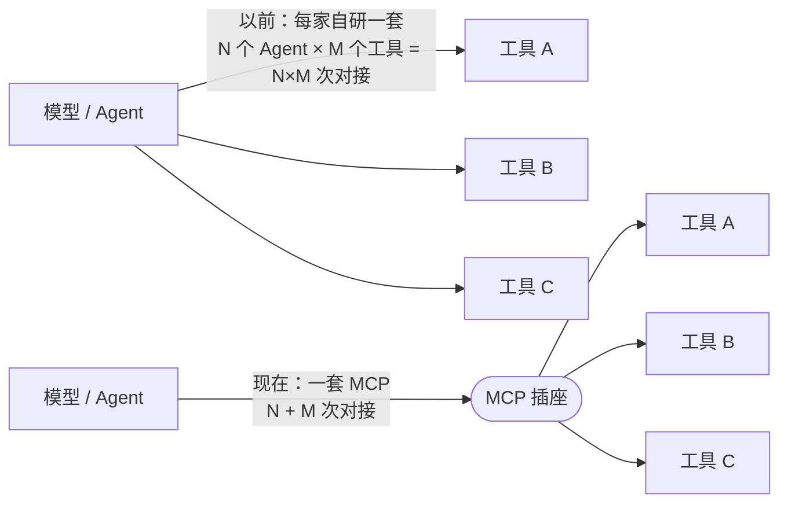
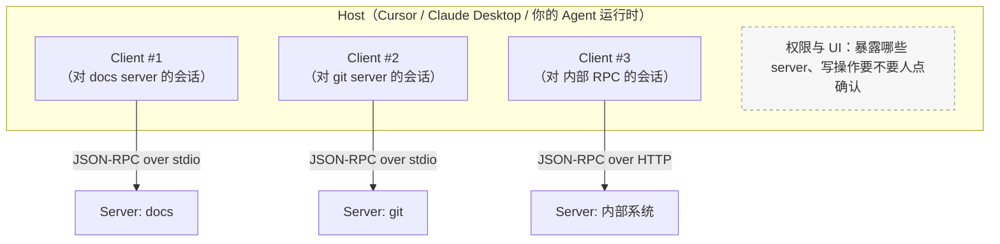
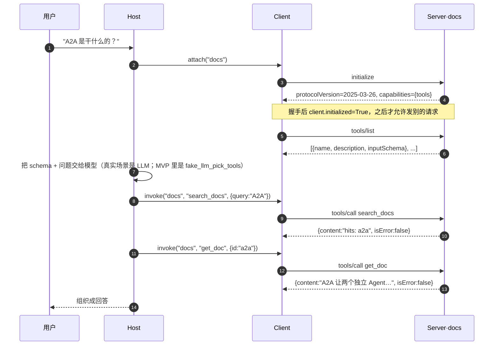
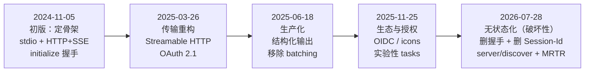
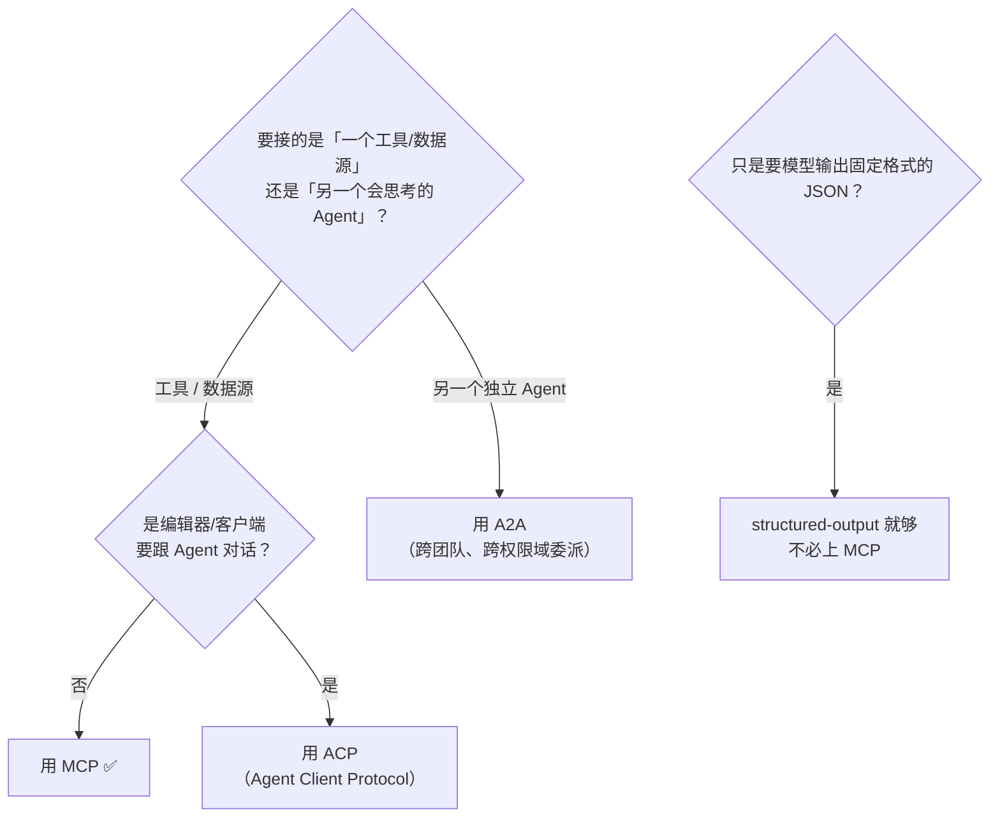

# MCP 理解指南（图解版）

> 这份文档是 [README.md](./README.md) 的「理解向补充」：README 回答「MCP 是什么、有哪些条目」，这份回答「为什么长这样、怎么记住、代码哪一行为什么这么写」。
> 适合：第一次接触 MCP 的人、以及临面试要把它讲清楚的人。

---

## 0. 三十秒版本

一句话：**MCP 把「模型怎么调用外部能力」从每家自研，收敛成一个 USB-C 接口。**



没有 MCP 时，每个 Agent 产品都要给每个工具写一遍适配；有了 MCP，工具团队只写一个 server，所有兼容的 Host（IDE / 桌面端 / 自研 Agent）立刻能插。

---

## 1. 三个类比，挑一个记住就行

| 类比 | 对应到 MCP | 这个类比想说明什么 |
|---|---|---|
| **USB-C** | 一个物理口插所有外设 | 强调的是「接口标准化、可插拔」 |
| **打印机驱动** | 工具厂商写驱动，操作系统不关心打印机内部 | 强调的是「解耦：工具侧维护，Host 侧只管发现与调用」 |
| **人的手和眼睛** | tools = 手（能做事），resources = 眼睛（能看） | 强调的是「能力分类」 |

反过来的提醒：**MCP 不是大脑**。它不负责规划、记忆、多步循环——那是 [LangGraph / 循环工程](../loop-graph/) 的事。MCP 只管「手和眼睛怎么接上」。

---

## 2. 角色图：Host / Client / Server 到底谁是谁

最容易混的是 **Host 和 Client**。记法：**Host 是应用，Client 是应用里开的「一条连接」**。



- **Host**：进程本身。负责拉起 server、管理多条连接、弹权限确认、把结果塞回模型上下文。
- **Client**：Host 内部对**某一个** server 的协议会话。挂 3 个 server 就有 3 个 client。
- **Server**：独立进程（本地 stdio 子进程）或远程服务。它**不知道**谁在编排它，也不该知道。

对应到 `mvp.py`：`Host.attach(alias, server)` 里 new 一个 `McpClient`，就是上面「一条连接」这条线。

---

## 3. 一次调用长什么样（对着 mvp.py 的真实输出看）



实际跑 `python3 mvp.py` 的输出（可直接对照上图的第 5、7、9 步）：

```text
=== initialize ===
{'protocolVersion': '2025-03-26', 'serverInfo': {'name': 'docs', 'version': '0.1.0'}, 'capabilities': {'tools': {}}}

=== tools/list ===
  [docs] search_docs: 按关键词搜索内部文档。当用户问「有哪些资料/某某是什么」时使用。...
  [docs] get_doc: 按文档 id 读取全文。id 必须来自 search_docs 的 hits。...

=== 用户问题: A2A 是干什么的？ ===
tools/call search_docs{'query': 'A2A'} -> hits: a2a  error=False
tools/call get_doc{'id': 'a2a'} -> A2A 让两个独立 Agent 用 Agent Card 发现彼此并委托任务。  error=False
```

三个值得记住的细节：

1. **`inputSchema` 就是 JSON Schema**，和 OpenAI function calling 同构——所以从厂商 tools 迁到 MCP，模型侧几乎不用改。
2. **错误也在信封里**：`call_tool` 用 `{"isError": True, "content": [...]}` 返回，而不是抛异常崩掉进程。这样模型能看懂「我调错了」并改参重试（README 落地建议第 5 条）。
3. **工具描述是给模型看的，不是给人看的**：`search_docs` 的描述里写了「当用户问『有哪些资料』时使用」「id 必须来自 search_docs 的 hits」——模型选工具几乎只看这段字，写得含糊就会乱调。

---

## 4. 三类原语：别把 resources 当成 tool

| 原语 | 谁触发 | 类比 | 例子 |
|---|---|---|---|
| **Tools** | 模型决定调用（有副作用或需要计算） | 手 | `search_docs`、`get_doc`、`create_issue` |
| **Resources** | Host 决定何时塞进上下文（只读） | 眼睛 / 参考资料 | 文件内容、ticket 正文、库表 schema |
| **Prompts** | 用户或 Host 主动选 | 话术模板 | 「用公司风格写周报」 |

判据很简单：**需要模型在运行时「决定要不要做」的 → tool；只是给模型「看」的静态上下文 → resource。**

---

## 5. 版本演进：只看这一条主线

完整逐版清单在 [版本演进.md](./版本演进.md)。这里只给骨架，先建立时间感：



一句话主线：**把状态从协议层赶到应用层。**
动机很实在——有状态的长连接会话要粘性负载均衡、要共享会话存储、网关还得拆包检查；无状态之后，远程 MCP server 可以直接跑在普通轮询 LB、serverless、边缘节点后面。

⚠️ **本目录 `mvp.py` 停在 2025-03-26 的形状**（还有 `initialize` 握手和 `initialized` 标志）。如果按 2026-07-28 重写，改这三处：

| mvp.py 现状 | 2026-07-28 之后 |
|---|---|
| `McpClient.connect()` 调 `initialize()`，并断言 `self.initialized` | 无握手；版本与能力走**每请求 `_meta`**，不符返回 `UnsupportedProtocolVersionError` |
| 能力在连接时一次性拿到 | 改成调 **`server/discover`**（server 必须实现） |
| server 反向找 client 要信息（sampling / roots） | 改成 **MRTR**：结果里返回 `resultType="input_required"`，client 带 `requestState` 重发 |

这不代表 MVP 错了——它演示的是「协议形状」，而握手版形状更好懂。读的时候知道它站在时间线的哪一格就行。

---

## 6. 选型决策：什么时候用 MCP



再加一条经济判据：**你只有一个 Agent 且工具都在同一个进程里**——直接写函数调用，别上 MCP。MCP 的价值来自「跨进程、跨团队、跨产品复用」，用不上这个价值时它是纯成本。

---

## 7. 常见误解（FAQ）

| 误解 | 正解 |
|---|---|
| 「MCP 让模型变聪明了」 | 不。MCP 只扩展「能调用什么」，推理与规划能力不变，工具选错照样错。 |
| 「上了 MCP 就安全了」 | 恰恰相反，它扩大了攻击面。MCP 不管策略，**危险写操作必须在 Host 或[护栏层](../../reliability/guardrails/)拦**。 |
| 「resources 和 tools 差不多」 | resources 是 Host 塞给模型看的只读上下文，tools 是模型主动发起的动作，触发方不同。 |
| 「MCP 和 A2A 二选一」 | 生产栈通常两层都要：Agent 用 A2A 委派给另一个 Agent，那个 Agent 再用 MCP 调自己的工具。 |
| 「tool 描述随便写写」 | 模型选工具几乎只看 description。写清「何时用 / 入参约束 / 有无副作用」，是最便宜的准确率优化。 |
| 「server 应该做成万能大服务」 | 一个 server 只做一件领域的事（git、工单、检索），用 Host 组合。巨型 server 会让工具列表污染上下文。 |

---

## 8. 记忆锚点（面试口径）

1. **定位**：MCP = Agent→工具的连接标准，USB-C；不是大脑，是手和眼睛。
2. **三角色**：Host（应用，管权限与 UI）→ Client（对某个 server 的会话）→ Server（暴露 tools/resources/prompts）。
3. **三原语**：tools（做）、resources（看）、prompts（模板）。
4. **两传输**：本地 stdio，远程 Streamable HTTP（2025-03 起取代 HTTP+SSE）。
5. **主线**：状态从协议层赶到应用层；2026-07 全面无状态化，服务端主动能力改 MRTR。
6. **边界**：不规划、不记忆、不做多智能体；不管安全策略。

---

## 9. 相关

- [README.md](./README.md)：条目式技术讲解与落地建议
- [版本演进.md](./版本演进.md)：五个修订版的逐条变更与迁移建议
- [A2A](../a2a/)：Agent 之间怎么委派（含 [理解指南](../a2a/理解指南.md)）
- [ACP](../acp/)：编辑器 / 客户端 ↔ Agent 的界面接缝
- [环节 05 工具接入协议 MCP 详解](../环节05-工具接入协议MCP详解.md)
