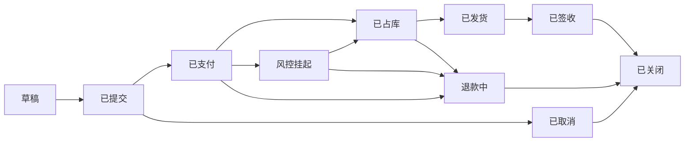

# 订单流转

> 同一条状态机写两遍。[OrderFlow.lean](./OrderFlow.lean) 证明「凡是走到已发货，历史上一定到过已支付」。[订单本体](../ontology/订单流转/) 只描述当前停在哪、允许哪条边，并推出订单属于哪个阶段。
>
> 发货门禁仍是另一问：[发货门禁.md](./发货门禁.md)。本页把「占库」看成一条边，不展开那四件叶子事实。

---

## 一、十条状态，十四条边



| 边 | 从 | 到 | 业务 |
|---|---|---|---|
| `submit` | 草稿 | 已提交 | 买家确认 |
| `pay` | 已提交 | 已支付 | 支付成功 |
| `cancelUnpaid` | 已提交 | 已取消 | 付款前取消 |
| `allocateClear` | 已支付 | 已占库 | 欺诈已排除，并且占库成功 |
| `flagRisk` | 已支付 | 风控挂起 | 命中风控 |
| `refundPaid` | 已支付 | 退款中 | 占库前取消 |
| `releaseHold` | 风控挂起 | 已占库 | 风控排除，并且占库 |
| `rejectHold` | 风控挂起 | 退款中 | 风控拒绝 |
| `refundAllocated` | 已占库 | 退款中 | 发货前取消 |
| `ship` | 已占库 | 已发货 | 承运商揽收 |
| `deliver` | 已发货 | 已签收 | 签收 |
| `closeDelivered` | 已签收 | 已关闭 | 售后期结束 |
| `closeRefund` | 退款中 | 已关闭 | 退款完成 |
| `closeCancelled` | 已取消 | 已关闭 | 未支付取消单归档 |

没有从草稿直接到已发货的边。已关闭没有出边。已签收之后的退货不在这台机器里。

阶段只是给状态贴的标签，不是另一套迁移：

| 阶段 | 状态 |
|---|---|
| 付款前 | 草稿、已提交、已取消 |
| 款已进入 | 已支付、风控挂起、已占库、退款中 |
| 已履约 | 已发货、已签收 |
| 已结束 | 已关闭 |

已关闭不放进「款已进入」。未支付取消也能关闭。

---

## 二、Lean 证明历史

[OrderFlow.lean](./OrderFlow.lean)。`Step` 的十四条构造子就是上表。`Hist` 是从草稿出发、沿这些边走出来的一条历史。

```bash
lean OrderFlow.lean
```

本机 Lean 4.34.1 下该命令通过。

| 定理 | 说的话 |
|---|---|
| `funded_saw_paid` | 凡是停在「款已进入」或「已履约」的历史，中间一定到过已支付 |
| `happy_saw_paid` | 确认 → 支付 → 占库 → 发货 → 签收，这条历史到过已支付 |
| `held_saw_paid` | 支付后先挂起、再放行发货，同样到过已支付 |
| `cancel_unpaid_never_paid` | 提交后直接取消再关闭，这条历史没有到过已支付 |
| `draft_cannot_ship` | 不存在草稿 → 已发货这一步 |
| `no_exit_closed` | 已关闭没有出边 |
| `ship_only_from_allocated` | 进入已发货的唯一上一步是已占库 |

`funded_saw_paid` 对**每一条**历史都成立，不靠举一两条样例。证明是对历史做归纳：进入已支付的那一步把「见过已支付」记下来，后面的边只是把它带下去。

---

## 三、Ontology 描述当前图

[order.ttl](../ontology/订单流转/order.ttl)。状态是个体，`mayProceedTo` 把十四条边写成数据，`hasStatus` 是函数性属性。

订单 A1042 当前是已发货。订单 B7 当前是已取消。文件里没有它们的历史。

```bash
cd ../ontology/订单流转
python3 reason.py
```

推出的是阶段，不是路径：

| 推出 | 依据 |
|---|---|
| `A1042 a FulfilledOrder` | 当前状态是已发货，已发货属于已履约 |
| `B7 a BeforePayOrder` | 当前状态是已取消，已取消属于付款前 |
| 每个状态 `a Status` | 四个阶段都是 `Status` 的子类 |

十四条 `mayProceedTo` 仍是文件里写上的，推理器没有从「已发货」推出「付过款」。

再断言 A1042 同时处于草稿：

```bash
python3 reason.py --contradict
```

`hasStatus` 是函数性的，草稿和已发货又 `differentFrom`。推理器把这两个状态并成同一个体，付款前和已履约因此相交，并报告不一致。这检查的是「此刻不能占两个状态」，不是「历史上必须经过已支付」。

---

## 四、两边各留什么

| 问句 | 谁回答 |
|---|---|
| 现在允许从已占库走到哪？ | Ontology 里的 `mayProceedTo`，Lean 里的 `Step` 构造子。两边都写了这张边表 |
| 这张订单现在算不算已履约？ | Ontology。读当前状态，推出 `FulfilledOrder` |
| 它能不能同时是草稿和已发货？ | Ontology。函数性 + 不相交，报不一致 |
| 每一条走到已发货的历史是不是都付过款？ | Lean 的 `funded_saw_paid` |
| 未支付取消再关闭，是不是可以从没付过款？ | Lean 的 `cancel_unpaid_never_paid` |

把「已履约的订单都付过款」写成 OWL 子类公理，只是人又声明了一句。它不是从十四条边推出来的。Lean 的那条定理才是从边推出来的。
