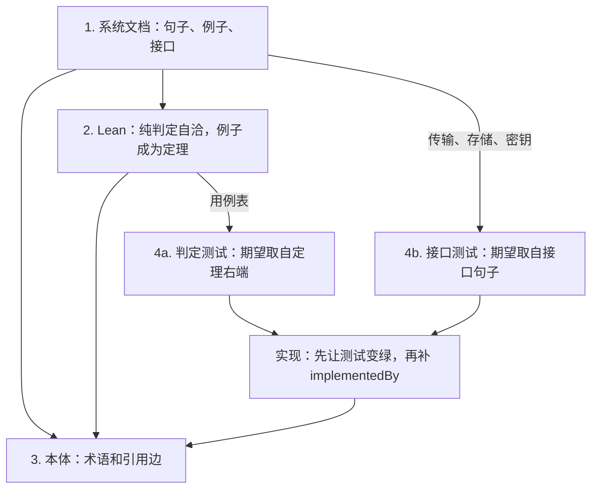

# 从业务文档到代码

> 学习笔记，2026-10-13。对象是「业务 wiki → agent 写代码和配置」。小例子是 [`examples/order-payment`](../../../examples/order-payment/)，完整切片是 [`abac-authz`](../../../abac-authz/)。
>
> 深的定义不在本页重复。Lean 的 kernel 与公理见 [lean/](./lean/)。OWL 与运营本体见 [ontology/](./ontology/)。知识库五维见 [knowledge-base/](./knowledge-base/)。

读完应能回答四件事：Lean 能抓住哪类业务 bug；本体能回答哪类问题和哪一类影响面；怎样把 Lean 里的等式变成 Go 测试；文档、证明、本体、测试、代码各写一次、各锁什么。

---

## 一、一条链，五份产物



| 步骤 | 在 ABAC 里落在 | 锁定的是 | 还没锁定的是 |
|---|---|---|---|
| 系统文档 | [`knowledge/`](../../../abac-authz/knowledge/index.md) | 人能读的规则、例子、接口 | 句子之间是否真能同时成立 |
| Lean | [`proof/`](../../../abac-authz/proof/README.md) | 纯判定自洽，演示账本每一行能从规则推出 | Go、HTTP、SQLite、解析器 |
| 本体 | 尚未单独立项；小样是 [`ontology.ttl`](../../../examples/order-payment/ontology.ttl) | 词只有一个意思，以及「谁引用谁」 | 状态怎么变；代码入口（边先空着） |
| 测试 + 实现 | [`internal/`](../../../abac-authz/internal/decision/decision_test.go) | 实现与已定期望一致 | 期望本身。期望来自前两步 |

改一条规则时沿同一条链往回走：先改文档句子，Lean 重新通过，本体查出还连着哪些定理和函数，用例 JSON 更新后 Go 测试变红，再改实现。

---

## 二、Lean 能校验什么

[`OrderPayment.lean`](../../../examples/order-payment/OrderPayment.lean) 把三条定义写成函数 `payable`、`paymentSucceeds`、`applyPayment`。定理 `order_becomes_paid` 用示例订单去撞这些函数：120 减 20 等于 100，待付款加上这笔付款变成已付款。`lake build` 通过，只说明在这个模型里该等式成立。

能抓住两类错：

- 两条规则不能同时成立。依赖两者的定理过不了。
- 规则推不出文档里的例子。例子写成定理右端，形式化之后推不出，构建失败。

还要另加检查的三道缝：

| 缝 | 构建结果 | 补法 |
|---|---|---|
| 文档相对真实业务写错，但句子自洽 | 通过 | 人签定理右端。右端从业务例子来，不从模型的运行结果抄回 |
| 同一次翻译把定义写弱，又按写弱后的定义写定理 | 通过 | 定理右端与 `def` 分开写。模型只填证明，或只填定义 |
| 实现没有按这些函数做 | 通过 | 由定理导出测试，打到实现上 |

[`abac-authz/proof/README.md`](../../../abac-authz/proof/README.md) 写明第二道缝的现状：证明按 `knowledge/` 的句子重写，不是从 Go 抽出来的。`lake build` 通过，说明 Lean 模型符合那些句子。

全称定理留在 Lean 里。`default_deny`、`deny_overrides_closed`、`clock_writes_now_hour` 量化了所有策略或所有环境，继续只由 `lake build` 检查。演示账本里已经有它们的具体行，那些行才导出成测试。

验收时分开看三件事：目标已关上、`#print axioms` 里没有 `sorryAx`、陈述由懂该规则的人签过。第三件 kernel 不代劳。细则在 [lean/README.md §三、§六](./lean/README.md)。

---

## 三、本体能回答什么

[`ontology.ttl`](../../../examples/order-payment/ontology.ttl) 开头写了分工：本体回答「有哪些东西、如何区分、定义是什么」。「这笔订单变为已付款」是 Lean 里的定理。

功能问答里，本体适合：有哪些类、状态如何区分、应付金额的定义是哪条、付款连到哪张订单。Agent 回答「这个功能是什么」时，用它锁术语，句子本身仍以 wiki 为准。

「付 99 元会怎样」走 Lean 的 `applyPayment`，它返回「付款金额与应付金额不一致」。TTL 里没有这条错误。`markPaidRule` 的 head 是再加上 `hasStatus = paid`，body 仍要求原来的 `pending`。`hasStatus` 又是函数属性，推理器得到的是「既待付款又已付款」，不是一次状态更新。业务系统里的状态变迁写成返回新值的函数。

影响面是沿引用边走。改「应付金额 = 商品金额 − 优惠」时，本体能找出 `paymentSucceedsRule`、`markPaidRule`，以及带 `:payableAmount` 的个体。这条结果只包含写成三元组的边。要盖住实现侧，每个规则、配置键、代码入口都要是个体，并用 `implementedBy`、`configuredBy` 连上。代码还不存在时，这两条边空着，第 4 步函数落地后再补。

Lean 侧的影响面是另一条通道：改 `payable` 之后，依赖它的定理会构建失败。两边合在一起，才是「定义变了，哪些规则、哪些证明、哪些实现入口要重看」。

本体在 Lean 之后落，用的是已经稳定的词。定义的正文指向文档锚点和定理名，不在 SWRL 里再写一套会分叉的规则。

---

## 四、从 Lean 导出测试

导出的是 `rfl` 定理里已经写死的输入和期望，不是证明项，也不是导出时再跑一遍函数得到的结果。

[`Seed.lean`](../../../abac-authz/proof/Abac/Seed.lean) 的 `demo_same_dept_read` 就是一行：主体 `alice`、资源 `doc-eng`、动作 `read`、决策时钟 `10`，期望 `allow`，命中 `pol-dept-read`，双方来源都是 `stored`。右端来自 [`demo-catalog.md`](../../../abac-authz/knowledge/contexts/authorization/demo-catalog.md) 的核对表。

```lean
theorem demo_cases_hold :
    demoCases.all (fun c =>
      seedDecide c.subject c.resource c.action c.hour c.extra = c.expect) = true := by
  native_decide
```

`Outcome` 已有 `DecidableEq`，有限表可以用 `native_decide`。`main` 只打印 `demoCases`。`lakefile.toml` 增加可执行目标后：

```sh
cd proof && lake exe export-cases > ../internal/decision/testdata/demo-cases.json
```

JSON 提交进仓库。Go 测试不依赖 Lean 工具链。

Go 侧的比对对象：

| 导出内容 | 调用 | 比对 |
|---|---|---|
| `Seed.lean` 的 `demo_*` | `decision.Service.Decide` | `Decision`、命中 id 的顺序、两侧来源、`Reason`；期望为错误时比对 `BadRequest` 的消息 |
| `Replay.lean` 的 `replay_*` | `engine.Decide` | 合并结果。条件在 Lean 里是语法树，导出时带上 Go 解析器认得的字符串，例如 `"true"` |
| `unknown_subject_denied_despite_allow_all` | 先写入再决策 | 单独成组，JSON 里带上那条无条件允许策略 |

`hour` 是决策时钟参数，不写进请求环境。`AuditID` 留在 Go 里单独断言，Lean 的 `Outcome` 没有审计号。

[`TestDemoDecisions`](../../../abac-authz/internal/decision/decision_test.go) 是同一张表的手写副本，而且只覆盖了其中 7 行。封存、未登记主体、`now_hour` 非法在别的测试函数里。导出之后这些行从同一份 JSON 进来。

HTTP、SQLite、Bearer、正则仍用 `server_test.go` 和 `store_test.go`。它们的期望抄自 [`interfaces.md`](../../../abac-authz/knowledge/contexts/authorization/interfaces.md)，不从 Lean 导出。

---

## 五、第 4 步：规格驱动，测试先写

第 4 步不再写一份需求。规格在前三步已经定完。这一步只做两件事：把已定的期望收成先失败的测试，再写刚好让它通过的代码。

规格驱动决定期望从哪来。测试驱动决定书写顺序：测试先红，实现再绿。

一个切片是一条已经写死的行为：

1. 点名出处。判定切片的出处是定理名，例如 `demo_offhours_denies`。接口切片的出处是接口文档里的一句，例如「决策结果为拒绝时 HTTP 仍是 200」。
2. 把期望原样写进测试。此时实现不存在，测试是红的。
3. 写实现，直到这批测试变绿。
4. 函数落地后，补上本体的 `implementedBy`。

同一轮里，期望和实现分开写。期望只许从定理右端或文档句子来。实现偏了，红的是测试。若连期望一起改，Lean 那一侧的定理会先失败。

切片沿依赖往下排：

| 顺序 | 行为 | 测试出处 | 实现落点 |
|---|---|---|---|
| 1 | 条件求值 | `Expr.lean` 里的具体等式 | `internal/expr` |
| 2 | 三种合并 | `Replay.lean` | `internal/engine` |
| 3 | 一次决策 | `Seed.lean` 的 `demo_*` | `internal/decision` |
| 4 | 目录写入 | `Directory.lean` 里写死输入输出的定理 | `internal/store` |
| 5 | HTTP、密钥、分页、种子事务 | `interfaces.md` | `internal/api`、`cmd/abacd` |

前四行可以导出成 JSON。第五行 Lean 没有对应的项。

---

## 六、需要补的学习

按「不补就会把这条链用错」排序。每一项写到能做后面的练习为止，不把教材读完。

### 先补（否则判断会错）

| 主题 | 学到能做这件事 | 从哪读 |
|---|---|---|
| 命题即类型；`def` 与 `theorem` 的差别；`rfl` | 指出 `order_becomes_paid` 的类型是命题、值是证明项，右端是期望 | [lean/README.md §四](./lean/README.md)；[Theorem Proving in Lean 4](https://lean-lang.org/theorem_proving_in_lean4/) 前四章 |
| 可计算与可判定 | 说明为什么 `DecidableEq` 让 `native_decide` 能判有限表，全称定理不能这样导出 | 同上，外加 Lean 手册里 `Decidable` 一节。对着 `Seed.lean` 看 |
| kernel、`sorry`、公理白名单 | 列出 ABAC 证明的验收命令：`lake build`、无 `sorry`、`#print axioms` | [lean/README.md §三](./lean/README.md) |
| 陈述翻译 | 用一句话说清：构建通过锁定的是模型，人签的是「这句 Lean 就是那句中文」 | [lean/README.md §六](./lean/README.md)；社区清单 [did you prove it](https://github.com/leanprover-community/leanprover-community.github.io/blob/lean4/templates/did_you_prove_it.md) |
| 开放世界与单调性 | 解释 `markPaidRule` 为什么得到不一致，而不是把状态改掉 | [ontology/学术本体.md §一](./ontology/学术本体.md)；对照 [`ontology.ttl`](../../../examples/order-payment/ontology.ttl) 的 `markPaidRule` |
| 封闭世界的判定 | 把「待付款且金额相等则变成已付款」写成返回新值的函数，并写出金额不等的错误 | [`OrderPayment.lean`](../../../examples/order-payment/OrderPayment.lean) |
| 精化 | 指出 ABAC 的 Lean 与 Go 是两份实现，证明不自动转移到 Go | [`proof/README.md`](../../../abac-authz/proof/README.md) 开头和「没有纳入模型的部分」 |

### 接着补（否则第 3、4 步做不完）

| 主题 | 学到能做这件事 | 从哪读 |
|---|---|---|
| Lake 可执行目标 | 写一个 `main : IO Unit`，把用例表印成 JSON，并在 `lakefile.toml` 里登记 | [Functional Programming in Lean](https://lean-lang.org/functional_programming_in_lean/) 的 IO 章；本页第四节 |
| 测试分层 | 把 ABAC 现有测试分成三堆：从定理来的判定测试、从接口句子来的契约测试、留在 Lean 里的全称性质 | 本页第四节、第五节；[`decision_test.go`](../../../abac-authz/internal/decision/decision_test.go)、[`server_test.go`](../../../abac-authz/internal/api/server_test.go) |
| 期望的来源纪律 | 改一行 Go 时能指出期望字符串抄自哪条定理或哪句接口文档 | [`demo-catalog.md`](../../../abac-authz/knowledge/contexts/authorization/demo-catalog.md)、[`interfaces.md`](../../../abac-authz/knowledge/contexts/authorization/interfaces.md) |
| 追溯 | 画一张小表：文档锚点、定理名、JSON 行、Go 函数。缺一条就标空 | 本页第一节的表。本体边用 `implementedBy` 这个名字 |
| 图上的影响面 | 给定一个属性名，列出引用它的规则和个体。先手写这张表，再考虑 SPARQL | [`ontology.ttl`](../../../examples/order-payment/ontology.ttl)。查询语法要学时再读 SPARQL 的 SELECT / WHERE，不必先学推理器 |
| 通用语言 | 解释 ABAC 为什么按授权上下文写，同一个词在词汇表里只有一个意思 | [`knowledge/index.md`](../../../abac-authz/knowledge/index.md)、[`glossary.md`](../../../abac-authz/knowledge/contexts/authorization/glossary.md) |
| 例子即规格 | 指出核对表「不是规则」，规则在决策过程里，表只提供定理右端 | [`demo-catalog.md`](../../../abac-authz/knowledge/contexts/authorization/demo-catalog.md) 开头 |

规格驱动与测试驱动没有单独的教材依赖。规格驱动在这里的意思是：期望值在写代码之前已经落在文档句子或定理右端。测试驱动在这里的意思是：那个期望先变成失败的测试，再写实现。两者叠在同一切片上，见第五节。

### 用到再补

| 主题 | 什么时候才需要 | 入口 |
|---|---|---|
| OWL 剖面 EL / QL / RL / DL，以及选哪个推理器 | 真的要让推理器跑蕴含，而不是只做术语图 | [学术本体.md §三](./ontology/学术本体.md)；先跑 [出口合规](./ontology/出口合规/) |
| SHACL | 要检查「这份数据缺字段」，而不是推蕴含 | [学术本体.md](./ontology/学术本体.md) 里和 SHACL 的分工 |
| 运营本体的 Action | 人和 Agent 要在权限内改同一业务对象，并留审计 | [ontology/README.md §三](./ontology/README.md) |
| 属性图 / GraphRAG | 影响面节点多到 TTL 文件翻不动，或问答要沿多跳关系走 | [agent/loop-graph/](../agent/loop-graph/) |
| LLM Wiki 的维护方式 | 文档本身要由模型整理、人复核 | [知识库类型整理 §五](./knowledge-base/知识库类型整理.md) |
| 基于性质的测试 | 想在 Go 里抽查全称定理的有限实例。默认仍把全称留在 Lean | Go 侧 `testing/quick` 或同类库。ABAC 当前不依赖它 |
| 多仓上的 agent 工作流 | 切片跨多个仓库、要拆人实现 | [sdlc.md](../agent/multi-agent-research/sdlc.md) |

### 这条链上先不学

- Mathlib、数学形式化课本。ABAC 的证明不依赖 Mathlib。
- 自动定理证明器、SMT 求解器。这里要的是 kernel 检查一份写好的项。
- Isabelle、Rocq、Agda 的对照。工具链已经钉在 Lean 4.34.1。
- 描述逻辑的复杂度证明。选型口诀够用之前不必证。
- Palantir 产品的操作步骤。要学的是 Action 与 Role 这组概念，见上表。

---

## 七、建议怎么学

按这个顺序，每步做完再往下。材料都在仓库里。

1. 读 [`OrderPayment.lean`](../../../examples/order-payment/OrderPayment.lean) 和 [`ontology.ttl`](../../../examples/order-payment/ontology.ttl)。用自己的话写出：哪三句话在两边都有，哪一句只在 Lean 里。
2. 读 [`knowledge/index.md`](../../../abac-authz/knowledge/index.md) 的阅读顺序，再读 [`demo-catalog.md`](../../../abac-authz/knowledge/contexts/authorization/demo-catalog.md) 的核对表。把表中一行标到 [`Seed.lean`](../../../abac-authz/proof/Abac/Seed.lean) 的定理名上。
3. 在 `proof/` 里执行 `lake build`。打开一条 `demo_*` 定理，确认它是 `rfl`。再打开 [`proof/README.md`](../../../abac-authz/proof/README.md) 里「没有纳入模型的部分」。
4. 读 [`decision_test.go`](../../../abac-authz/internal/decision/decision_test.go) 的 `TestDemoDecisions`，列出核对表里有、这个测试里没有的行。那些行就是导出 JSON 时要补上的。
5. 读 [lean/README.md](./lean/README.md) 的第三节和第六节，对照第 3 步的构建，写出这条证明的三条验收。
6. 读 [学术本体.md §一](./ontology/学术本体.md)，回到 `markPaidRule`，写出推理器给出不一致的原因。
7. 最后看第六节的「接着补」。此时再写 `export-cases`，而不是先写导出器。

---

## 八、本页不展开

- 导出器的 Lean 源码和 Go 测试代码。第四节只固定数据从哪来、打到哪个函数。
- ABAC 本体的 Turtle。第三节固定它该连哪些边，文件尚未写。
- HTTP 每一条状态码。以 [`interfaces.md`](../../../abac-authz/knowledge/contexts/authorization/interfaces.md) 为准。
